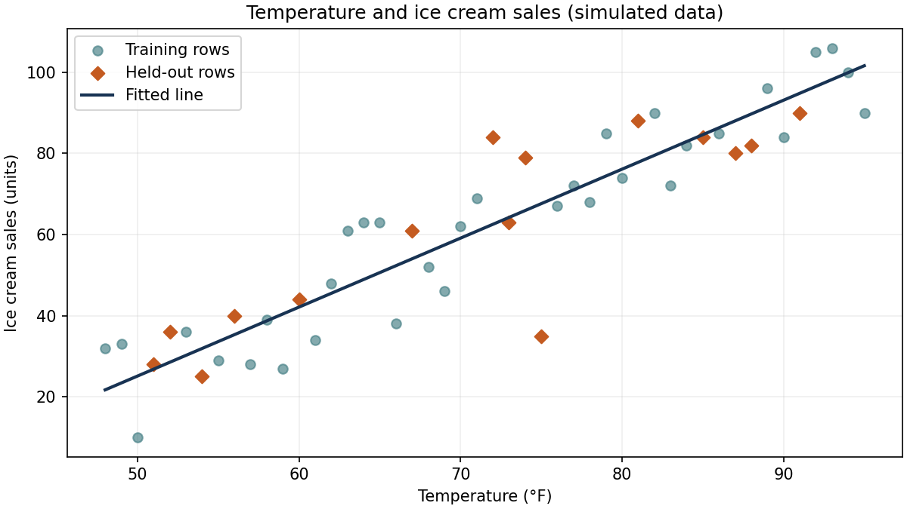

# Michaelina King | Data Analytics Portfolio

**Data analyst · Python, SQL, Excel and Power BI · M.S. in Data Science**

I turn raw records into data that teams can use for analysis and reporting. My background includes database maintenance, data validation and operational reporting at Bordelais Correctional Facility. I earned an M.S. in Data Science from Monroe University in 2024.

## Selected projects

| Project | Question | Tools and evidence |
| --- | --- | --- |
| [Temperature and Ice Cream Sales](projects/ice-cream-sales.md) | What can temperature tell us about ice cream sales? | Python, pandas, scikit-learn · case study and runnable regression demo |
| [Wine Preference Analysis](projects/wine-preferences.md) | How can a retailer organize wine listings and use ratings as a proxy for preference? | Python, pandas · CRISP-DM capstone case study |
| [Wine Quality and Chemistry](projects/wine-quality.md) | How do wine quality scores vary across wine types and chemistry measurements? | SAS, PROC SQL · exploratory analysis case study and SQL excerpt |
| [Prison Release and Recidivism](projects/recidivism.md) | What can release and recidivism records tell us about reported patterns? | Python, R · collaborative exploratory analysis |
| [Prison Sentence Patterns](projects/sentence-patterns.md) | How do recorded sentence lengths vary across age groups and states? | R, dplyr, ggplot2 · collaborative visualization study |

## Featured work sample

[Run the temperature and sales demo](examples/ice-cream/README.md) to see a complete workflow with input validation, a reproducible train/test split, a mean baseline, held-out error metrics and a plot. The chart uses **simulated data**.

## Experience and tools

- **Data quality and reporting:** Validated records, maintained institutional databases and prepared data for administrative and operational reports.
- **Analysis:** Python, pandas, R, SQL, SAS and Excel for cleaning, querying, exploratory analysis and statistical modeling.
- **Business intelligence:** Power BI dashboard design, KPI reporting, filters and slicers. My résumé also lists student performance analysis in Python and Excel.

## Contact

Use the contact details on my résumé or reach out through the GitHub profile hosting this repository.
